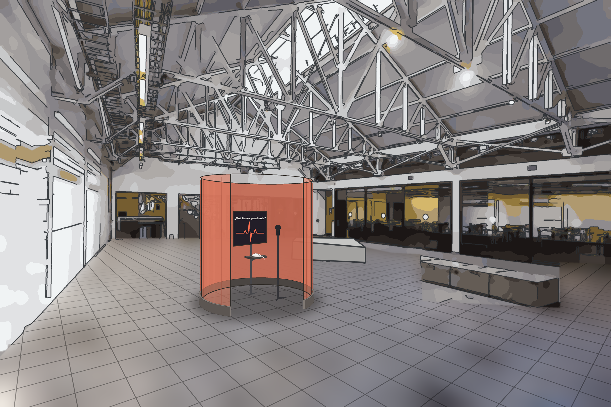
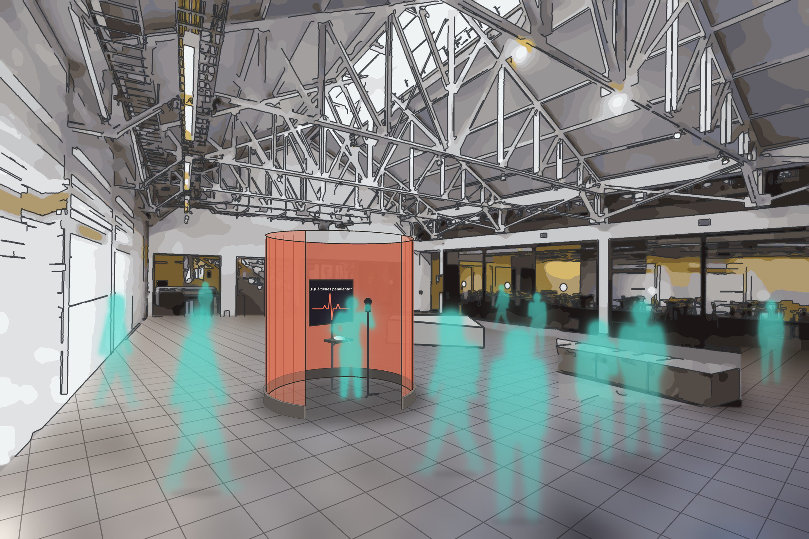
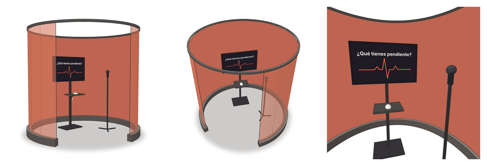

# Escala 02

## Encargo visualización Diseño Abierto

### Propuestas de temas que registrar

**¿Qué tienes pendiente?**

Todos cargamos con algo que quedó sin cerrar: una conversación que no tuvimos, un proyecto que no terminamos, algo que no hemos soltado o a lo que no hemos vuelto. Son cosas que pesan, pero que casi nunca decimos en voz alta. Nuestra propuesta parte de ahí: **darle a la comunidad un lugar para confesar sus pendientes** y, al reunirlos, mirar qué dicen de nosotros en conjunto.

Para eso instalamos en el **patio central** un **confesionario**: un módulo envuelto por una **tela en forma de cilindro**, con una **pantalla**, un **micrófono** y un **mouse** en su interior. Adentro, de forma **anónima**, cada persona responde una sola pregunta.

**Pregunta de la cabina**

> **¿Qué tienes pendiente?**

Es corta, directa y se responde sin pensarlo mucho. Una variante más ritual, que refuerza la idea de confesionario, sería **"Confiesa un pendiente"**.

**Pregunta de investigación**

> **¿Qué deja pendiente una comunidad, y qué revelan esos pendientes sobre lo que posterga?**

Un pendiente individual habla de una persona; muchos pendientes juntos hablan de una comunidad. Si la mayoría posterga lo que tiene que **decir** más que lo que tiene que **hacer**, o si lo que más se arrastra son los **vínculos** y no los **estudios**, eso revela qué estamos dejando para después y por qué. Para responderla nos preguntamos:

- **¿De qué tratan** los pendientes de la comunidad?

- **¿Qué tipo de acción** se posterga más: hacer, decir, soltar, volver, empezar o terminar?

- **¿Qué nos impide** cerrarlos?

- **¿Cómo nos hace sentir** lo que dejamos pendiente?

No trabajamos con el sonido de la voz, sino con **lo que se dice**: el audio se **transcribe a texto**, se analiza y se descarta. En pantalla nunca aparecen las palabras exactas de nadie, solo la **idea reformulada** de cada pendiente.

## Etapas de visualización de datos

Según **Ben Fry**:

### Adquirir

¿Qué podemos observar y cómo podemos registrar información?

Nuestros datos son **las confesiones transcritas**. La persona entra a la cabina, la pantalla le hace la pregunta, hace **clic en el mouse para empezar a hablar** y otro **clic para terminar**. Un **micrófono** conectado a un computador registra lo que dice y un sistema de **transcripción de audio a texto** (Whisper, ajustado al español de Chile) lo convierte en texto.

Cada vez que alguien se confiesa, el sistema registra:

- **El texto transcrito** de lo que dijo.

- **La hora** en que lo dijo.

- **La duración** de la confesión.

El audio **no se guarda**: se transcribe y se elimina en el momento.

### Analizar

¿Qué información o datos estamos obteniendo?

A partir de cada texto, el sistema extrae la **idea principal** del pendiente y la clasifica. Obtenemos una **tabla de registros**, en donde cada fila corresponde a un pendiente:

| Hora | Pendiente (reformulado) | Temática | Verbo | Desde cuándo | Emoción | Obstáculo |
|---|---|---|---|---|---|---|
| 10:32 | Pedirle perdón a un amigo | Vínculos | Decir | Años | Nostalgia | Miedo |
| 13:15 | Terminar la tesis | Estudios | Terminar | Meses | Angustia | Tiempo |
| 17:48 | Volver a dibujar por gusto | Uno mismo | Volver | Años | Calma | Cansancio |

*Ejemplo ilustrativo, no corresponde a datos reales.*

Las categorías que usamos son:

- **Temática:** de qué trata el pendiente (estudios, trabajo, vínculos, familia, uno mismo, salud y cuerpo, sueños y proyectos).

- **Verbo:** qué tipo de acción quedó abierta (hacer, decir, soltar, volver, empezar, terminar).

- **Desde cuándo:** días, meses o años.

- **Emoción:** con qué tono se dijo (alegría, calma, nostalgia, cansancio, angustia, tristeza, rabia).

- **Obstáculo:** qué lo detiene, si se menciona (tiempo, miedo, plata, cansancio, otra persona).

En bruto son muchas confesiones distintas, pero las categorías permiten compararlas.

### Filtrar

¿Qué datos nos interesa conservar en nuestra investigación?

Conservamos solo la **idea reformulada** del pendiente y sus **categorías**, junto con la **hora**.

Descartamos las **palabras vacías** (*el, la, de, que, y*), las **muletillas** (*eh, o sea, cachai*) y las **transcripciones erróneas**. Los **modismos chilenos** se traducen a un español neutro para que el sistema los entienda (*"estoy chato"* → *estoy cansado*).

Para **cuidar la privacidad**, eliminamos el **audio**, el **texto literal**, los **nombres propios**, las carreras y cualquier dato que pueda identificar a alguien. Las confesiones ofensivas o que expongan a otra persona **no se muestran**.

### Minar

¿Qué patrones o relaciones podemos descubrir en estos datos?

- **Temáticas más frecuentes:** de qué tratan la mayoría de los pendientes.

- **Verbo predominante:** si la comunidad tiene más pendientes por **hacer** o por **decir**.

- **Antigüedad:** qué pendientes se arrastran hace **años** y cuáles son recientes.

- **Temática × emoción:** de qué se habla con calma y de qué con angustia; aquí puede estar el hallazgo.

- **Obstáculos comunes:** qué es lo que más nos impide cerrar nuestros pendientes.

- **Variación en el día:** si en la mañana se confiesan cosas distintas que en la tarde o en la noche.

### Representar

¿Cómo podemos transformar estos datos en una forma perceptible?

Construimos un **campo de círculos que no se cierran**: cada pendiente es un **círculo abierto**, como una tarea que quedó a medias.

- **Abertura:** desde cuándo está pendiente; mientras más antiguo, más abierto queda el círculo.

- **Color:** la emoción con la que se dijo.

- **Agrupación:** los círculos se reúnen por **temática**.

- **Grosor del trazo:** el verbo (hacer, decir, soltar...).

- **Texto:** la idea reformulada recorre el borde del círculo, como un **caligrama**.

El pendiente más reciente aparece **destacado** unos segundos y luego se suma al conjunto. Al final de la jornada, la pantalla muestra **todo lo que la comunidad dejó abierto**.

### Afinar

¿Cómo hacemos que la visualización se entienda mejor?

- **Forma:** que cada círculo se lea como algo **inconcluso** sin necesidad de explicación.

- **Color:** una paleta clara por emoción, que también se distinga por forma y no solo por color.

- **Legibilidad:** un largo máximo para cada frase, letra legible a distancia y círculos que no se tapen cuando se acumulan.

- **Movimiento:** el pendiente nuevo se dibuja y brilla unos segundos; los anteriores se atenúan.

- **Simbología:** una leyenda simple que explique abertura, color y agrupación.

Antes de Diseño Abierto mostramos el boceto a compañeros y, si no leen lo que esperamos, ajustamos formas, colores o etiquetas.

### Interactuar

¿Cómo se relacionan las personas con el sistema?

**Dentro de la cabina**, la persona:

1. Lee la pregunta en pantalla y que todo es **anónimo** y el audio **no se guarda**.

2. Hace **clic** para empezar y **confiesa** su pendiente.

3. Hace **clic** para terminar.

4. **Ve su pendiente reformulado** y decide si **lo suelta** (se suma a la visualización) o **se lo guarda** (se descarta).

5. Al salir, ve su **círculo** aparecer junto al de los demás.

**Fuera de la cabina**, quienes pasan por el patio ven la visualización en una **pantalla exterior**. Pueden **filtrar por temática o emoción** y **recorrer la jornada** hora a hora para ver cómo cambiaron los pendientes durante el día.

La cabina también muestra los **servicios de apoyo** de la universidad: [servicio y contacto].

## Propuestas de comunicación gráfica

Más que mostrar lo que se dijo tal cual, queremos **transformar las confesiones en una imagen que responda la pregunta**: qué deja pendiente la comunidad y qué revela eso sobre lo que posterga.

La propuesta principal son los **círculos que no se cierran**. Otras alternativas que exploramos:

- **Hilos sueltos:** cada pendiente es un hilo que cuelga sin amarrar; los hilos de una misma temática se entrelazan.

- **Estratos:** los pendientes se acumulan como capas según su antigüedad; abajo los de hace años, arriba los de hoy.

- **La lista que nadie tachó:** una gran lista de tareas colectiva, sin ningún ítem marcado.

- **Cartas sin enviar:** cada pendiente de **decir** aparece como un sobre cerrado.

- **Frases que se desvanecen:** las confesiones aparecen nítidas y se borran lentamente, como algo que se suelta.

La cabina forma parte de la comunicación gráfica: la **tela coral** que envuelve el módulo hace visible desde lejos que ahí ocurre algo íntimo.

## Proceso

### Estrategia de registro

- **Lugar:** patio central, con la cabina al medio.

- **Horario:** jornada de Diseño Abierto, de 8:00 a 20:00.

- **Dispositivo:** cabina cilíndrica de tela con pantalla, micrófono y mouse sobre una repisa.

- **Captura:** una confesión por persona; el audio se transcribe y se elimina en el momento.

- **Anonimato:** no se registra quién habla, solo qué dice y cuándo.

### Variables

| Variable | Tipo | Cómo se obtiene |
|---|---|---|
| Hora | Cuantitativa | Registro automático |
| Duración | Cuantitativa | Registro automático |
| Pendiente | Texto | Idea principal extraída del texto |
| Temática | Categórica | Clasificación del texto |
| Verbo | Categórica | Clasificación del texto |
| Desde cuándo | Ordinal | Detectado en el texto (días, meses, años) |
| Emoción | Categórica | Análisis de emoción (pysentimiento + reglas propias) |
| Intensidad | Ordinal (1–5) | Análisis de emoción |
| Obstáculo | Categórica | Detectado en el texto, si se menciona |

### Simbología

### Tabla de datos

### Conclusiones

## Referentes

- [Mark Hansen and Ben Rubin: Listening Post, Real-Time Data Responsive Environment 2001](https://youtu.be/dD36IajCz6A?si=ZGM9awTIY4IwuAHH): muestra en pantallas fragmentos de lo que la gente escribe en internet, como una conversación colectiva.

- [Las llamadas que nunca hice, Juan José Acuña (2023)](https://paisajepublico.com/catalogo/las-llamadas-que-nunca-hice/): instalación sonora con un teléfono público que invita a llamar para decirle a alguien algo que nunca se le dijo. Las llamadas se graban y luego las escuchan otras personas, de modo que la confesión es íntima y a la vez compartida. Se presentó en el GAM y en el MAC de Santiago. Es muy cercano a nuestra cabina: un dispositivo cerrado, una voz que confiesa algo pendiente y un registro colectivo.

- **Before I Die, Candy Chang (2011):** un muro público donde las personas completan con tiza "Antes de morir quiero ___". Es el referente más cercano a nuestros pendientes.

- **PostSecret, Frank Warren (2004):** personas envían secretos anónimos en postales que luego se exhiben; muestra cómo el anonimato permite confesar.

- **¿Es usted feliz?, Alfredo Jaar (1979–1981):** intervención en Santiago que llevó una pregunta íntima al espacio público.

- [La isla [reconocimiento]](https://rkrause.cl/web/?page_id=4410): proyecto participativo en el que las personas construyen colectivamente un mapa a partir de sus aportes.
